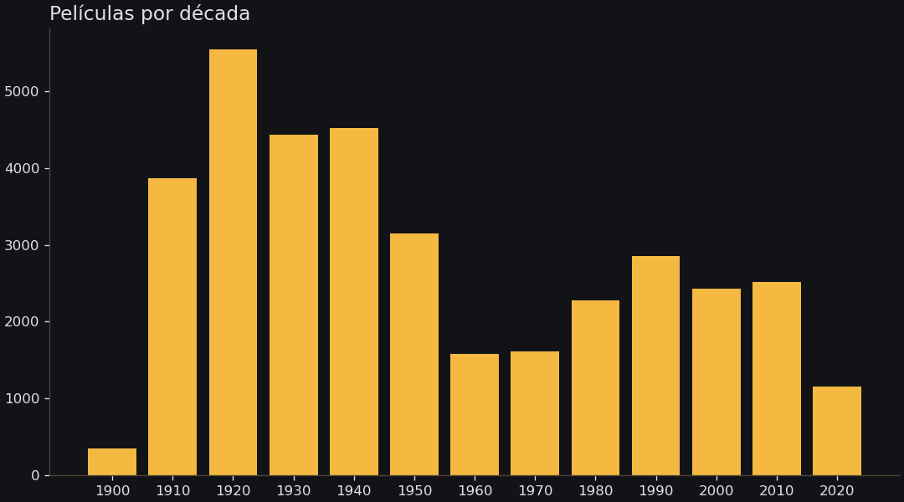
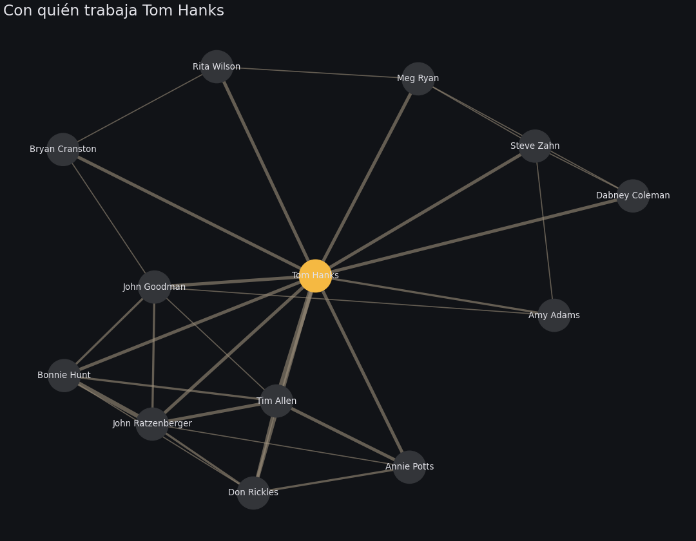

# logicDemo2 — Prolog llama a Python con Janus

Segunda parte de [`logicDemo`](../logicDemo/): la misma base de 36 273 películas, ahora
con **Janus**, el puente entre SWI-Prolog y Python. Prolog sigue siendo el programa:
deduce los datos y llama a Python solo para lo que Python hace mejor, que aquí es
estadística, gráficas (matplotlib) y análisis de grafos (networkx).

El tutorial está escrito para **Ubuntu Server 24.04** (también WSL y AWS Academy).

| Archivo | Qué hace |
|---|---|
| `analisis.pl` | Reglas que deducen los datos y llaman a Python con `py_call/2`. |
| `graficas.py` | Funciones de Python que dibujan; no deciden nada. |
| `servidor.pl` | Servidor web de Prolog que devuelve las imágenes. |
| `desde_python.py` | El sentido contrario, opcional: Python pregunta a Prolog. |

## 1. Instalación

```bash
sudo apt update
sudo apt install -y software-properties-common curl
sudo apt-add-repository -y ppa:swi-prolog/stable
sudo apt update
sudo apt install -y swi-prolog python3-matplotlib python3-networkx
```

La PPA es necesaria: el SWI-Prolog de los repositorios de Ubuntu 24.04 es la versión 9.0,
anterior a Janus.

Comprueba que Prolog ve a Python:

```bash
swipl -g "use_module(library(janus)), py_call(sys:version, V), writeln(V)" -t halt
```

Debe imprimir la versión de Python, por ejemplo `3.12.3 (main, ...) [GCC 13.3.0]`.

> **Janus:** biblioteca de SWI-Prolog que incrusta el intérprete de Python en el mismo
> proceso. No hay servidor intermedio ni JSON: Prolog llama funciones de Python
> directamente y los datos se convierten solos.

## 2. Los datos

La demo usa la base de `logicDemo`. Si aún no la descargaste:

```bash
cd ../logicDemo && ./descargar.sh && cd ../logicDemo2
```

## 3. Primeras llamadas

```bash
swipl analisis.pl
```

`analisis.pl` carga `library(janus)` y la deja disponible en la consola.
`py_call(Modulo:Funcion(Argumentos), Resultado)` llama a Python:

```prolog
?- py_call(math:sqrt(2), X).
X = 1.4142135623730951.

?- py_call(statistics:mean([3, 5, 10]), M).
M = 6.

?- py_call(len("backtracking"), N).
N = 12.
```

Cómo viajan los datos:

| Prolog | Python |
|---|---|
| Entero, flotante | `int`, `float` |
| Átomo `'Tom Hanks'` o cadena `"The Matrix"` | `str` |
| Lista `[1, 2, 3]` | `list` |
| `true`, `false` | `True`, `False` |
| `nombre = Valor` como último argumento | argumento con nombre (`nombre=valor`) |

## 4. Prolog deduce, Python calcula

`reparto_tipico/2` junta con backtracking el tamaño del reparto de cada película y le
pide la estadística a Python:

```prolog
reparto_tipico(Media, Mediana) :-
    findall(N,
            ( pelicula(Id, _, _),
              aggregate_all(count, actua(Id, _), N),
              N > 0 ),
            Ns),
    py_call(statistics:mean(Ns), Media),
    py_call(statistics:median(Ns), Mediana).
```

```prolog
?- reparto_tipico(Media, Mediana).
Media = 3.7658456671562535,
Mediana = 3.0.
```

La lista `Ns` tiene más de 35 000 números y cruza a Python en una sola llamada.

## 5. Gráficas con matplotlib

```prolog
?- grafica_decadas(Archivo).
Archivo = 'salida/decadas.png'.

?- grafica_generos(Archivo).
?- grafica_actor('Tom Hanks', Archivo).
```



El nombre del actor va como átomo, entre comillas simples, igual que en la base.

Cada regla tiene la misma forma: una consulta que deduce las listas y una llamada que las
dibuja.

```prolog
grafica_decadas(Archivo) :-
    findall(D-N, aggregate(count, Id^decada(Id, D), N), Pares),
    pairs_keys_values(Pares, Decadas, Cuantas),
    salida('decadas.png', Archivo),
    py_call(graficas:barras("Películas por década", Decadas, Cuantas, Archivo), _).
```

`graficas` es el archivo `graficas.py` de esta carpeta. Prolog lo encuentra porque
`analisis.pl` agrega la carpeta a la ruta de Python con `py_add_lib_dir/1`.

Las imágenes quedan en `salida/`. En un servidor sin pantalla puedes copiarlas a tu
máquina con `scp`, o verlas desde el navegador con el servidor del paso 7.

## 6. Grafos con networkx

`red_de/2` arma en Prolog la red de un actor: sus doce compañeros más frecuentes y las
películas que comparten entre sí. Python la dibuja:

```prolog
?- grafica_red('Tom Hanks', Archivo).
```



Y también puede devolver un resultado para que Prolog siga razonando con él:

```prolog
?- centrales('Tom Hanks', 3, Lista).
Lista = ['Tom Hanks'-0.558, 'John Goodman'-0.053, 'Meg Ryan'-0.015].
```

`centrales/3` pide a networkx la intermediación de cada actor en esa red y recibe una
lista que Prolog convierte en pares `Actor-Puntaje`.

> **Quién hace qué:** qué actores entran a la red y cuántas películas comparten lo
> decide Prolog, con las mismas reglas de `logicDemo`. Python no consulta la base: solo
> recibe listas y devuelve un dibujo o un número.

## 7. Servidor web

```bash
swipl servidor.pl          # http://localhost:8081/
```

| Ruta | Responde |
|---|---|
| `/` | Página con las cuatro gráficas; `/?actor=Meryl Streep` cambia de actor. |
| `/grafica/decadas` | PNG de películas por década. |
| `/grafica/generos` | PNG de los 15 géneros con más películas. |
| `/grafica/actor?nombre=Tom Hanks` | PNG de películas por año del actor. |
| `/grafica/red?nombre=Tom Hanks` | PNG de su red de colaboraciones. |

En AWS Academy abre el puerto 8081 en el grupo de seguridad de la instancia y entra con
su IP pública. En WSL basta `http://localhost:8081/` desde Windows.

La página se escribe con `library(http/html_write)`, que representa el HTML como
términos Prolog.

## 8. El sentido contrario (opcional)

Janus también permite que Python pregunte a Prolog. Hace falta instalar el paquete de
Python, que se compila contra tu SWI-Prolog:

```bash
sudo apt install -y build-essential python3-dev python3-venv
python3 -m venv --system-site-packages venv
venv/bin/pip install janus-swi
venv/bin/python desde_python.py
```

```python
import janus_swi as janus

janus.consult("../logicDemo/consultas.pl")
for r in janus.query("titulo_contiene(matrix, Id, Titulo, Anio)"):
    print(r["Anio"], r["Titulo"])
```

Imprime las cuatro películas de Matrix y después
`{'truth': True, 'Primer': 1980, 'Ultimo': 2023, 'Cuantas': 59}`. Cada solución del
backtracking llega como un diccionario de Python. En el curso el
gemelo se entrega en el primer sentido, con Prolog como programa; este apartado solo
muestra que el puente es de dos vías.

## Para seguir

- Escribe `grafica_genero_por_decada/2`: cómo cambia un género a lo largo del tiempo.
- Cambia `betweenness_centrality` por otra medida de networkx y compara quién queda
  arriba.
- Añade al servidor una ruta que reciba dos actores y dibuje el camino de `camino/3`.
