# Evidencias — #70 Alumbrado público

*González Cristóbal Omar · 23212707*

Volver al [README](../README.md) · [Manual de uso](../docs/MANUAL.md)

## Video de la demo

[Ver en Loom](https://www.loom.com/share/7e4e065c5a2d4c8fa7ebc59dfeba7b6c) — demostración sin voz: pruebas, arranque en la Pi, interfaz, reporte manual, escenarios, prueba de caos y simulador. La explicación se presentó en clase.

## Capturas

| # | Archivo | Qué demuestra | Criterio |
|---|---|---|---|
| 1 | `01-pruebas-eunit.png` | `rebar3 compile` sin advertencias y `rebar3 eunit` con 34 tests y 0 fallos (los `killed` son pruebas que matan procesos a propósito). | Solución funcional, calidad del código |
| 2 | `02-nodo-en-la-pi.png` | El nodo corriendo en la Raspberry Pi virtual: versión de OTP, `rebar3 shell`, PID del beam y puerto 8080. | Ejecución en la VM |
| 3 | `03-api-catalogo.png` | `curl` del catálogo: resumen (5,000 luminarias, 128 circuitos, 7 sectores), una luminaria y el 404 de `L-9999`. | Solución funcional |
| 4 | `04-api-flujo-reporte.png` | `curl` del flujo de reporte: nueva, agrupada, asignar, reparar, detalle y bitácora. | Solución funcional, integración |
| 5 | `05-diseno-stitch.png` | Las pantallas diseñadas en Google Stitch (`design/`). | Diseño de la interfaz (UX) |
| 6 | `06-mapa-sectores.png` | Mapa de Tijuana con los 7 sectores y las fallas por color (captura de la versión con mapa SVG; la interfaz ahora usa un mapa real de OpenStreetMap). | Integración backend / interfaz |
| 7 | `07-simulador-en-marcha.png` | Tarjeta del simulador con día, reportes, asignadas y reparadas, y el mapa llenándose. | Demo, integración |
| 8 | `08-escenario-poste.png` | 15 reportes sobre el mismo poste: aviso "1 falla nueva, 14 agrupados" (una sola falla, no 15). | Solución funcional (caso difícil) |
| 9 | `09-escenario-circuito.png` | Falla de un circuito completo (C-CEN-01): aviso de 40 luminarias y cúmulo de puntos rojos en el centro del mapa. | Solución funcional (caso difícil) |
| 10 | `10-detalle-ubicacion.png` | Detalle de una falla con mini mapa, dirección, sector, circuito, tipo de lugar y coordenadas. | Integración backend / interfaz |
| 11 | `11-bitacora.png` | Bitácora de eventos, del más reciente al más antiguo, con búsqueda por ID y filtros. | Solución funcional |
| 12 | `12-prueba-de-caos.png` | Se mata una falla con `exit(P, kill)`: el conteo de hijos baja de 41 a 40, el supervisor lo reporta sin reiniciarla y `p70_registro:buscar/1` ya no la encuentra; las demás siguen vivas. | Solución funcional (tolerancia a fallos), argumentación técnica |
| 13 | `13a`–`13e` (`13a-opencode-plan.png`, `13b-opencode-plan-pasos.png`, `13c-opencode-resumen.png`, `13d-opencode-resumen-tabla.png`, `13e-opencode-advertencias.png`) | Flujo con el agente de apoyo (Paso 7c-1): plan primero, aprobación de cada comando, y resumen final con pruebas y advertencias. | Uso de IA |

### 01. Pruebas

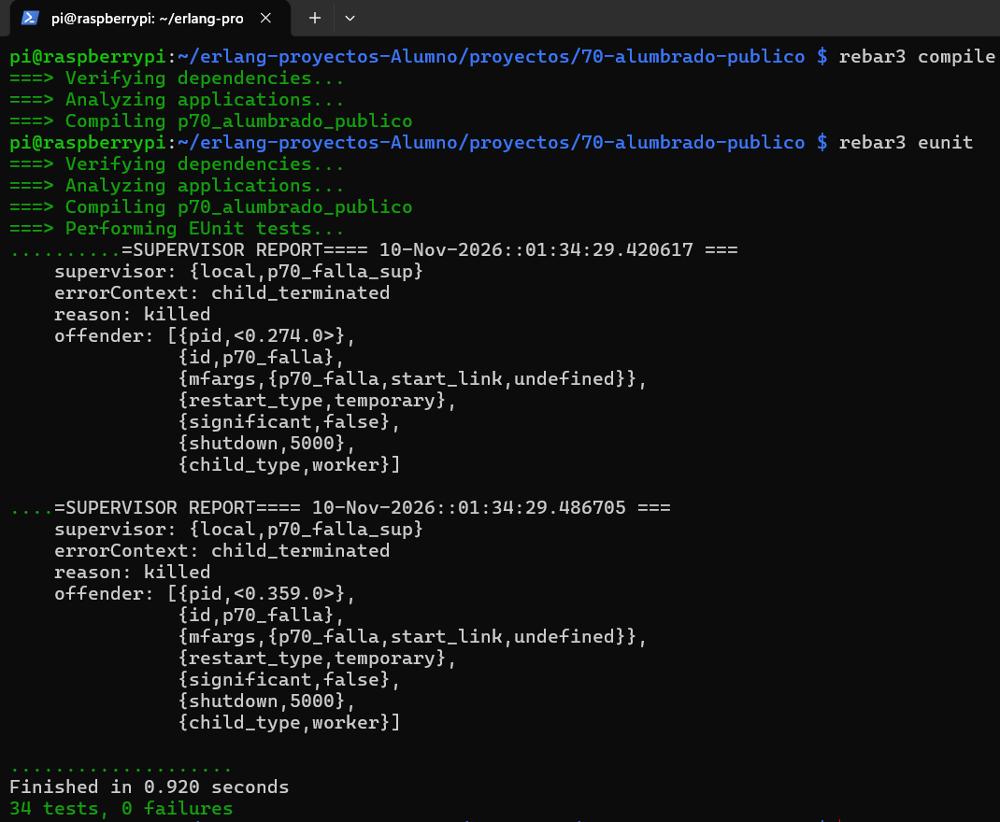

### 02. Nodo en la Pi

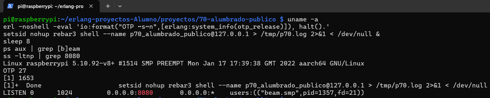

### 03. API: catálogo

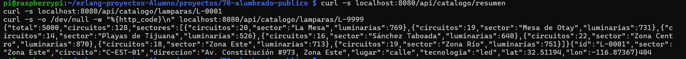

### 04. API: flujo de reporte

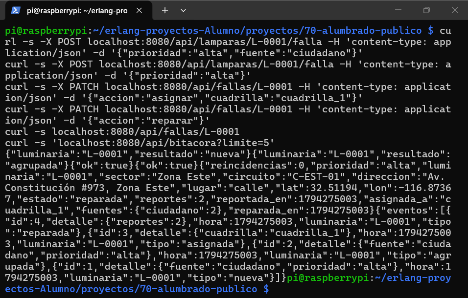

### 05. Diseño en Stitch

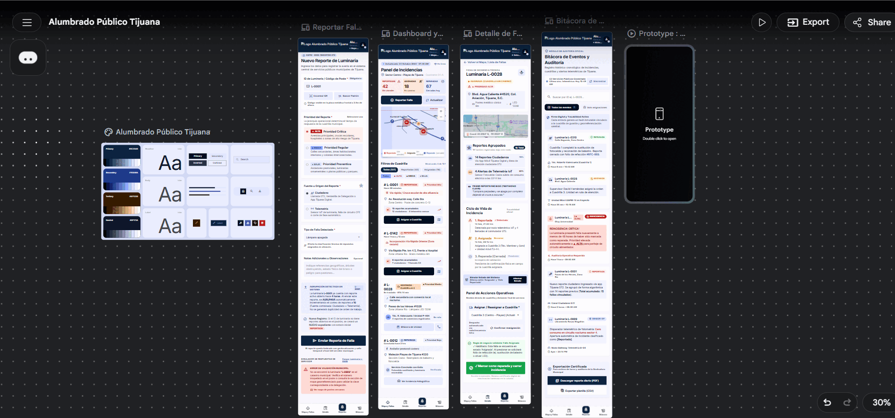

### 06. Mapa y sectores

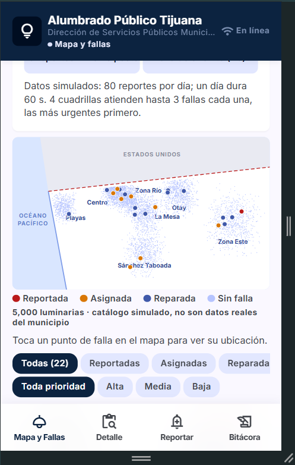

### 07. Simulador en marcha

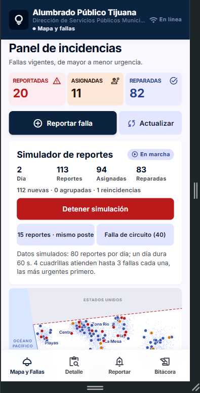

### 08. Escenario: 15 reportes en un poste

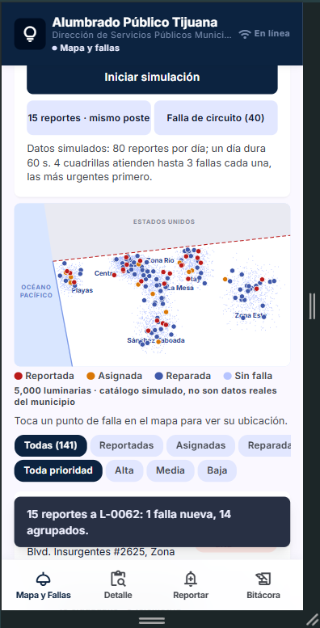

### 09. Escenario: falla de circuito

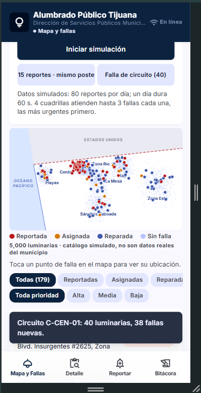

### 10. Detalle con ubicación

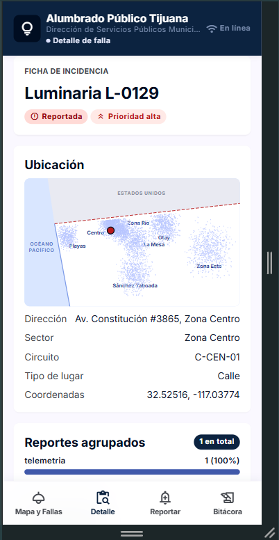

### 11. Bitácora

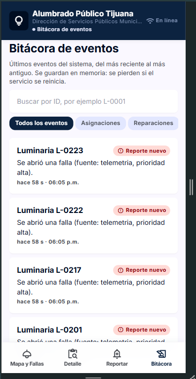

### 12. Prueba de caos

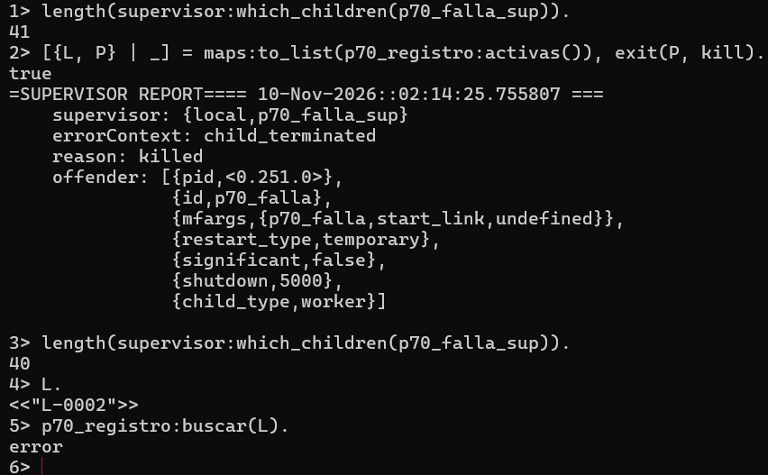

### 13. Flujo con el agente (Uso de IA)

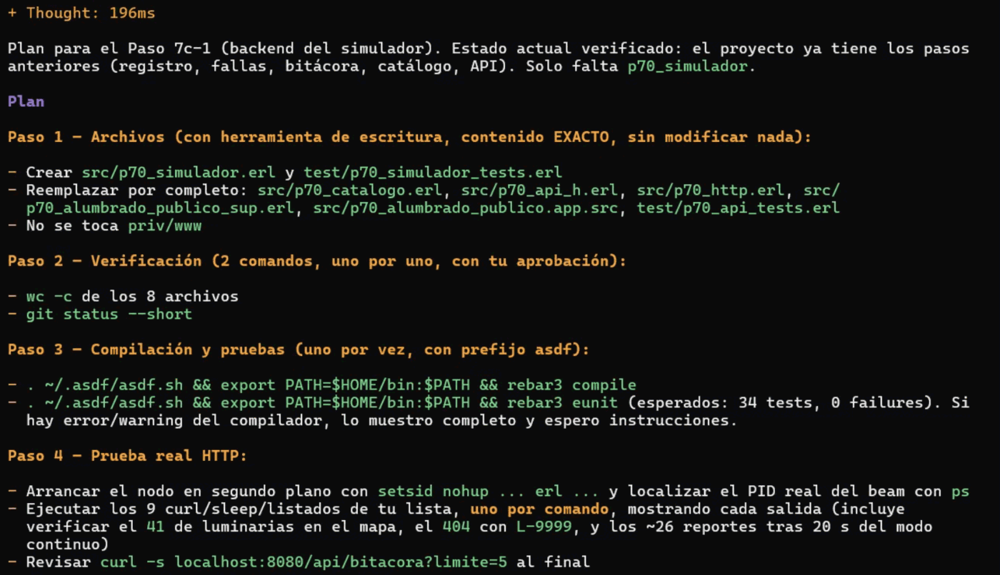

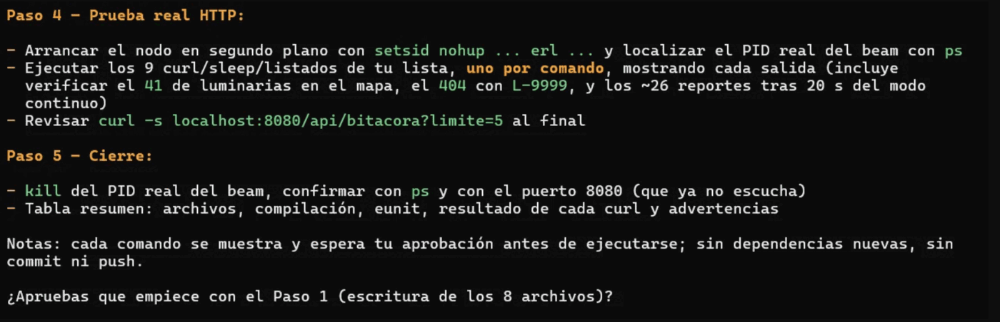

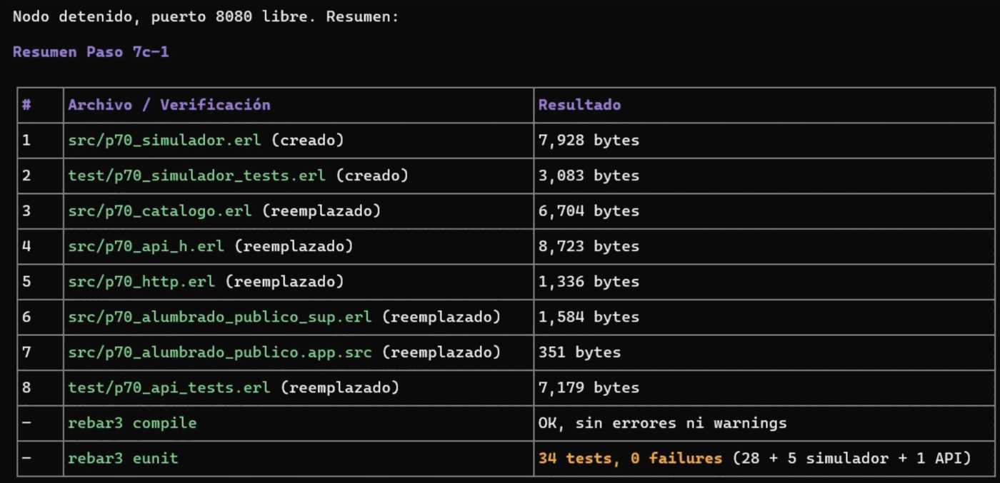

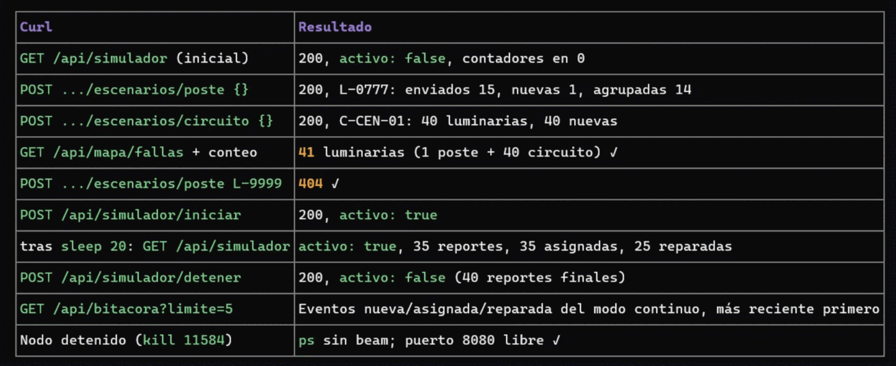

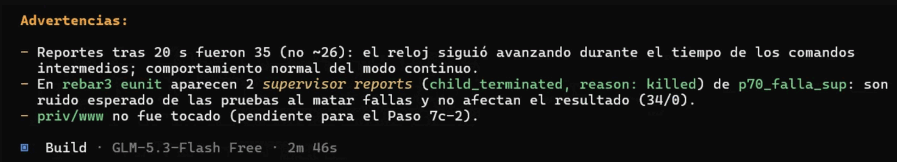

## Cobertura de la rúbrica

| Criterio | Dónde se cubre |
|---|---|
| Solución funcional en Erlang | `src/`, `test/`; capturas 01, 03, 04, 08, 09, 11 y 12 |
| Ejecución en la máquina virtual | Raspberry Pi 4 virtual (Corellium); captura 02 y video |
| Demo | [Video en Loom](https://www.loom.com/share/7e4e065c5a2d4c8fa7ebc59dfeba7b6c) y presentación en clase |
| Interfaz en Google Stitch | `design/` y captura 05; interfaz integrada en `priv/www` |
| Manual de uso | [`docs/MANUAL.md`](../docs/MANUAL.md) |
| Calidad del código | Un módulo por responsabilidad, 34 pruebas eunit, compilación sin advertencias (captura 01) |
| Integración backend / VM / interfaz | Capturas 06, 07 y 10: la interfaz lee la API real del nodo en la Pi |
| Presentación y argumentación técnica | Decisiones de diseño en el [README](../README.md) y exposición en clase |